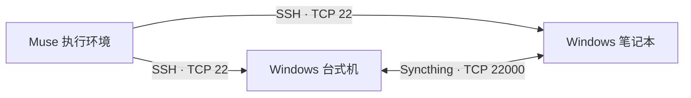

# Windows 双机互联与文件同步入门

用 Tailscale 把 Windows 台式机和笔记本加入同一专网，通过 Syncthing 双向同步指定目录。需要用 Muse 执行远程命令时，再为两台电脑配置 Windows OpenSSH。

| 你想完成什么 | 跟着哪一节做 | 怎样确认成功 |
| --- | --- | --- |
| 让台式机和笔记本互相找到 | [第一章 A1 · 加入同一个专网](01-muse-ssh.md#a1-两台-windows-加入同一个专网) | 两台电脑分别收到对方的 `tailscale ping` 回复 |
| 让 Muse 分别连接两台 Windows | [第一章 A2–A8 · 配置并验证 SSH](01-muse-ssh.md#a2-确认-muse-通过哪里访问-windows) | Muse 分别运行 `hostname` 和 `whoami`，看到正确的设备和账号 |
| 在笔记本和台式机之间双向传文件 | [第二章 · Syncthing 双向同步](02-syncthing.md) | 两端各创建一个小文件，另一端均收到，同名文件的 SHA-256 一致 |

只想传文件时，依次做 **A1 → B1–B5**。完整配置 Muse 时，从 A1 做到 A8。每一步都标明在哪台设备操作、填写什么、看到什么再继续。

Tailscale 提供加密专网。Muse 可以原生加入专网，也可以通过其平台提供的代理接入。两台 Windows 使用自己的 SSH 登录规则和公钥授权。Syncthing 单独配对设备，并且只同步你选中的目录。

## 开始之前

- 准备两台可在本地操作的 Windows 电脑，以及安装服务和设置防火墙所需的管理员权限。
- 需要远程执行命令时，确认 Muse 执行环境支持 SSH，并能访问这两台 Windows 的专网地址。使用平台代理时，以平台给出的代理命令和出口地址为准。
- 准备两个空目录做文件同步练习。双向同步会传播修改和删除，正式文件请先做好独立备份。
- 演练中的地址、用户名和路径用你自己的值替换。公钥授权只需传送 `.pub` 文件，私钥留在发起连接的一端。

## 常见卡点

- **Tailscale 一直显示 Starting…**。先确认设备拿到了专网 IP，再测试对端。如果同时使用带 TUN 和虚拟 DNS 的代理工具，可以短暂切换 TUN 设置对照测试，观察 Tailscale 是否恢复。同步和 SSH 都依赖实际可达的网络。
- **SSH 只能经笔记本到台式机**。从 Muse 新建台式机会话，检查 Windows 显示的连接来源和防火墙允许范围。测试配置保留平台要求的代理命令，去掉笔记本跳板，再用笔记本离线时的新连接验收。
- **Syncthing 显示设备已连接但看不到文件**。在两端检查共享邀请是否已接受、文件夹 ID 是否相同，以及文件是否放进了实际共享的本地路径。

[下载 Word 版逐步教程](windows-remote-collaboration.docx)

本仓库的原创教程和示例按 [CC BY 4.0](LICENSE) 许可发布。第三方软件请从各自的官方渠道获取。
